# LoRa RF Fingerprinting: Capture & Dataset Pipeline

This repository contains the pipeline for capturing raw LoRa IQ signals via SDR, extracting the complex preambles, and formatting the data.

For hardware assembly and setup instructions, see [Building the LoRa IQ Capture Setup](Building_LoRa_IQ_Capture_Setup.md).

## Prerequisites & Environment Setup

### 1. GNU Radio (Radioconda)

For MacOS, we use Radioconda to manage the GNU Radio environment and necessary SDR drivers. Follow the installation and configuration guide at the official repository: https://github.com/radioconda/radioconda-installer

### 2. Python Dependencies

Once your radioconda environment is installed, you must install the Python dependencies into that same environment and specified in requirements.txt

## Execution Pipeline

Ensure the SDR and LoRa HAT are connected via a USB port of the computer and configured. If the LoRa HAT has not been previosuly configured, set the device in configuration mode and use config_lora.py Python script for HAT configuration. Run the following scripts in the exact order listed below to record and process a single session:
1. In a terminal, run transmit_loop.py
2. In another terminal, run run_session.py to initiate the 60 seconds capture and extract preambles.
3. Verify the capture and preamble extraction.
4. Repeat the procedure for different LoRa HAT devices and sessions per device.

## Dataset

A curated sample of the dataset can be found at [OneDrive](https://fiudit-my.sharepoint.com/:u:/r/personal/llago016_fiu_edu/Documents/AIoT-Lab/dataset_npy.zip?csf=1&web=1&e=gWrtlf)

## Example

The following steps illustrate a typical workflow:

### Hardware

1. Unbox the LoRa HAT and the USRP SDR.

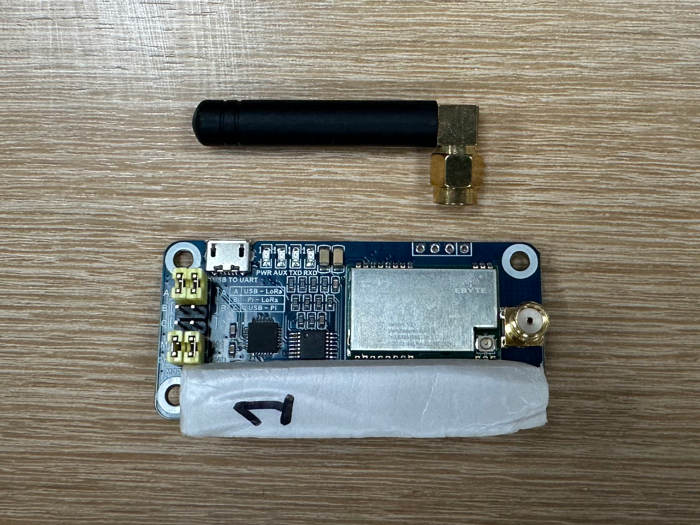

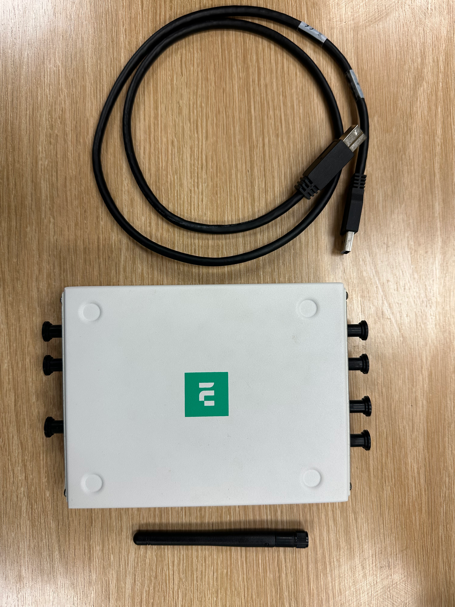

2. Configuration

Connect the LoRa HAT to the PC via USB with the M1 cap removed to enter configuration mode. Once connected, run `config_lora.py` to send the commands that configure the LoRa HAT with the desired parameters.

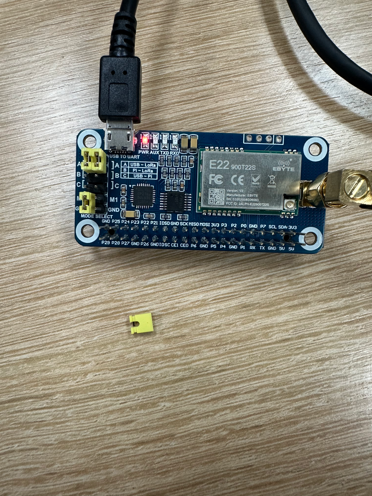

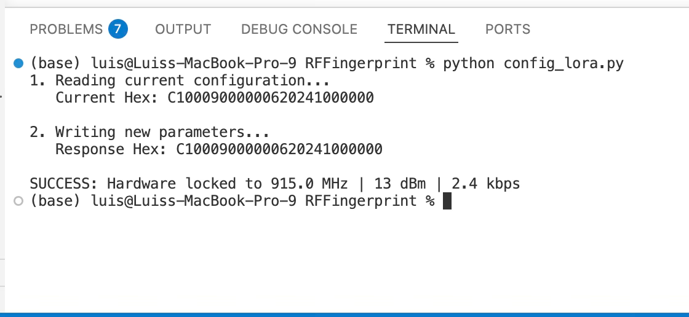

Once configured, replace the M1 cap to return the device to normal operating mode.

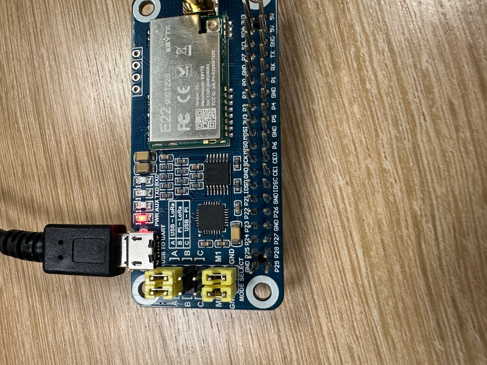

3. System Setup

Position the devices on their respective platforms to prepare for data transmission and USRP capture.

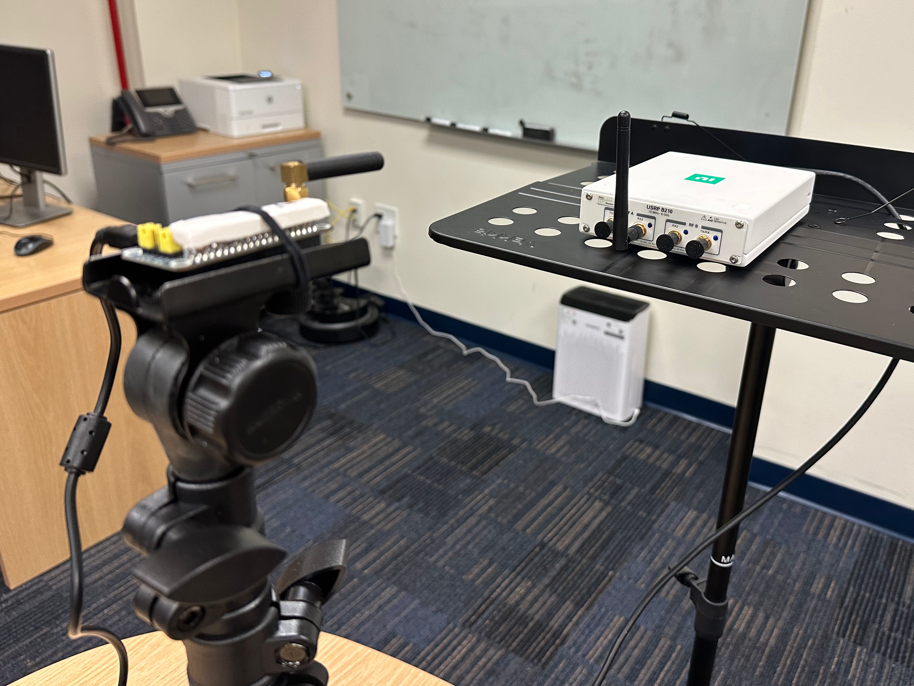

4. Transmission & Data Capture

Start LoRa HAT transmissions by running `transmit_loop.py`. The script executes a continuous loop of one burst followed by a 2-second pause, repeating indefinitely until interrupted with Ctrl+C.

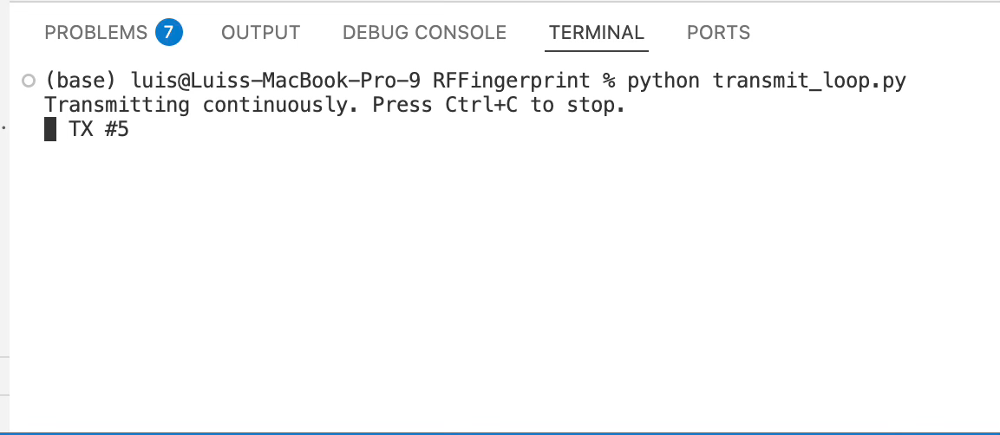

Before recording, verify that the parameters in `run_session.py` are correctly set: device label, capture duration (default: 60 seconds), USRP gain, and transmitter–receiver distance.

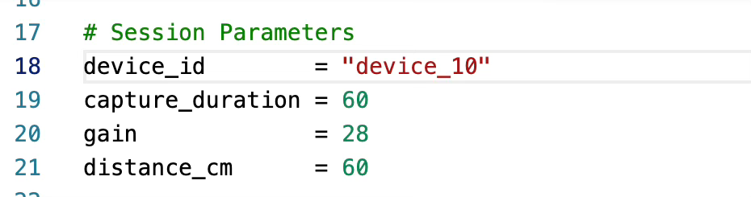

To record the transmissions, run `run_session.py`. The script captures the bursts transmitted by the LoRa HAT for the configured duration, displaying real-time transmissions in a waterfall frequency plot and spectrum visualization. Upon completion, the recorded I/Q data is saved to a directory named using the session parameters and timestamp for unique identification. The script then automatically extracts 8 consecutive preambles per burst, storing them as `.npy` files along with a visualization of the preambles from the first burst for verification.

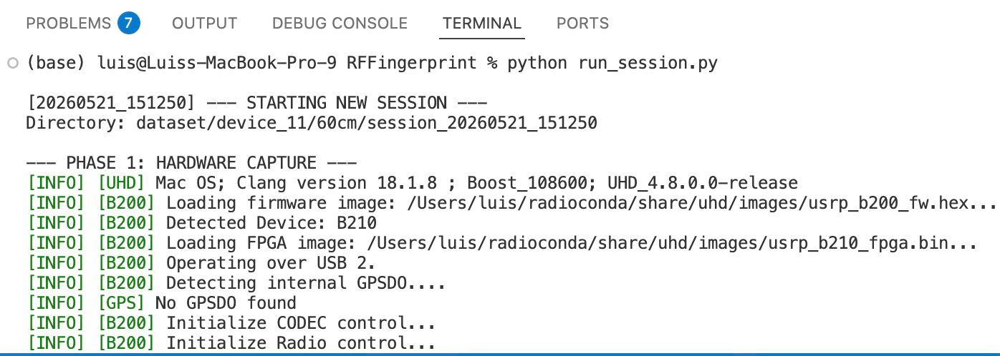

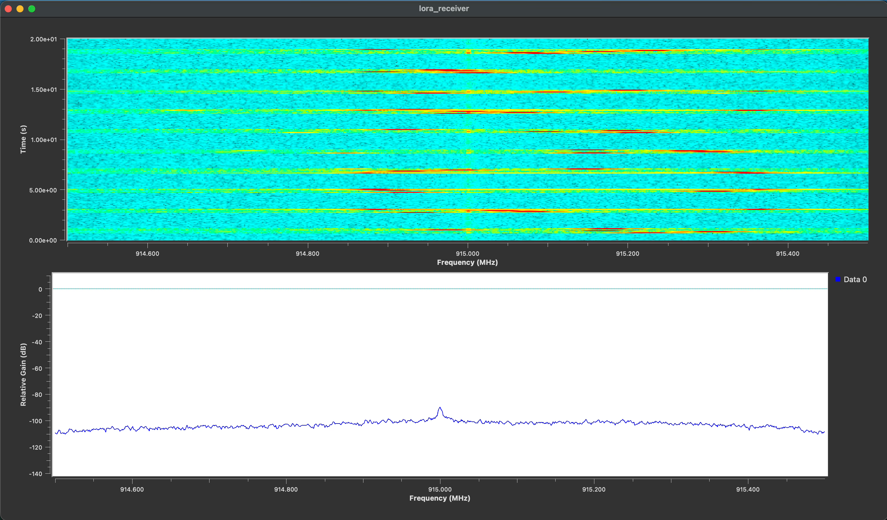

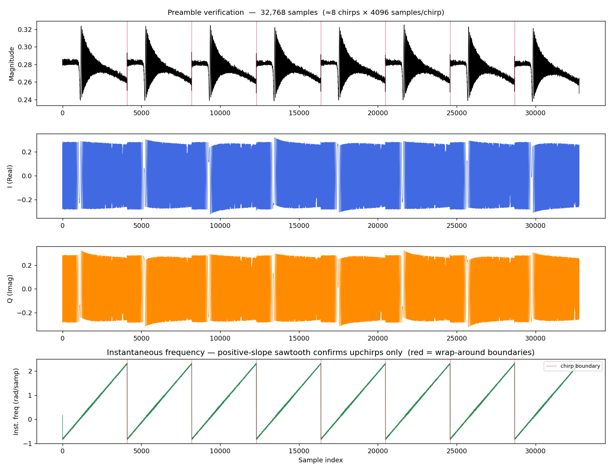